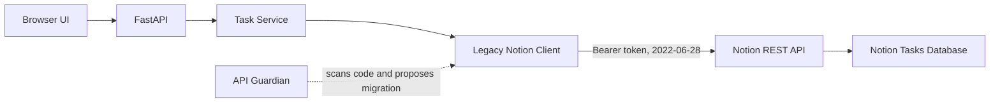

# Taskspace — Notion Task Manager (API Guardian Test Repository)

A complete small task manager with a FastAPI backend, responsive web UI, and **real Notion API authentication**. Designed as a separate GitHub repository for end-to-end testing of **API Guardian**, an automated API migration tool.

## Features
- Create tasks with Low / Medium / High priority
- List tasks from Notion (including pagination)
- Filter by To Do / In Progress / Done
- Change task status in Notion
- Archive tasks in Notion
- Responsive browser interface
- Swagger docs and offline mocked API tests
- `.env`-based token storage (no committed credentials)

## Architecture


## 1. Set up your Notion workspace
1. Go to [Notion integrations](https://www.notion.so/profile/integrations) and create an **internal integration** for your workspace. Enable read, insert, and update content capabilities. Copy its integration secret; keep it private.
2. Create a **full-page database** in Notion named `Tasks`. Make sure it is a database, not a simple table block.
3. Configure these database properties with **exact names and types**:

   | Property | Notion property type | Values |
   | --- | --- | --- |
   | `Name` | Title | Task name |
   | `Status` | Select | `To Do`, `In Progress`, `Done` |
   | `Priority` | Select | `Low`, `Medium`, `High` |

   **Important:** Use **Select** for `Status`, not Notion's separate built-in **Status** property type.
4. Open the database page's `...` menu → **Connections** → connect your new integration (the menu wording can vary).
5. Copy the database ID from its URL. It is the long identifier in the database URL; hyphens are optional.

## 2. Install and run

```bash
# From the project directory
python3 -m venv .venv
source .venv/bin/activate
python -m pip install -r requirements.txt
cp .env.example .env
```

Edit `.env`:
```env
NOTION_TOKEN=your_real_integration_secret
NOTION_DATABASE_ID=your_database_id
NOTION_VERSION=2022-06-28
```

Start the app:
```bash
python -m uvicorn app.main:app --reload
```

Open:
- **Task manager UI:** http://127.0.0.1:8000
- **API documentation:** http://127.0.0.1:8000/docs
- **Health:** http://127.0.0.1:8000/api/health

The health endpoint can work without a token, but the task endpoints require valid Notion credentials and access to the database.

## 3. Run tests
```bash
python -m pytest -q
```
Tests use `httpx.MockTransport` and a fake token. They do **not** call Notion or GitHub.

## 4. API endpoints
| Method | Endpoint | Action |
| --- | --- | --- |
| `GET` | `/api/health` | Health and configuration status |
| `GET` | `/api/tasks` | Read all non-archived tasks |
| `POST` | `/api/tasks` | Create task |
| `PATCH` | `/api/tasks/{task_id}` | Change status and/or priority |
| `DELETE` | `/api/tasks/{task_id}` | Archive task |

Example create request:
```json
{"title":"Finish API Guardian demo","priority":"High"}
```

## 5. Use this repository to test API Guardian

This application deliberately uses **Notion-Version `2022-06-28`**, including the legacy endpoint:

```http
POST https://api.notion.com/v1/databases/{database_id}/query
Notion-Version: 2022-06-28
```

Notion's `2025-09-03` API changed database/data-source behavior. A newer implementation uses:

```http
POST https://api.notion.com/v1/data_sources/{data_source_id}/query
Notion-Version: 2025-09-03
```

**Important:** This migration requires resolving the correct `data_source_id`, updating the API version, and checking related parent and property semantics. Blindly renaming `/databases/` to `/data_sources/` while keeping the database ID is not a valid migration. The older version may continue to work while explicitly pinned, so the demo is an **outdated API migration**, not necessarily a live outage.

Recommended test:
1. Push this project to a **separate GitHub repository**, without `.env`.
2. Verify the legacy app works against your Notion workspace.
3. Give API Guardian the repository URL and the relevant Notion migration changelog.
4. Have API Guardian scan `app/notion_client.py` and generate a migration plan.
5. Review its patch, run tests, and optionally validate against your Notion database.
6. Create a draft PR only after authorizing remote publishing in API Guardian.

**Note:** If API Guardian's publishing allowlist still contains only `sneha0832/api-guardian-test-repo`, update the allowlist through its approved configuration before attempting to publish to this new repository. A local scan or dry run does not require a remote push.

## Security
- Never commit `.env` or actual Notion tokens.
- Never put tokens into source files, changelogs, or AI prompts.
- The browser calls FastAPI; only FastAPI holds the token.
- Do not deploy this demo publicly without authentication and access controls.
- Notion permissions should be limited to the demo database.

## Known limitations
- No end-user login or multi-user separation.
- No deployment configuration or background jobs.
- Uses Notion's legacy database API intentionally.
- Assumes exact `Name`, `Status`, and `Priority` property schema.
- Does not automatically detect Notion changelog changes; that is API Guardian's responsibility.
